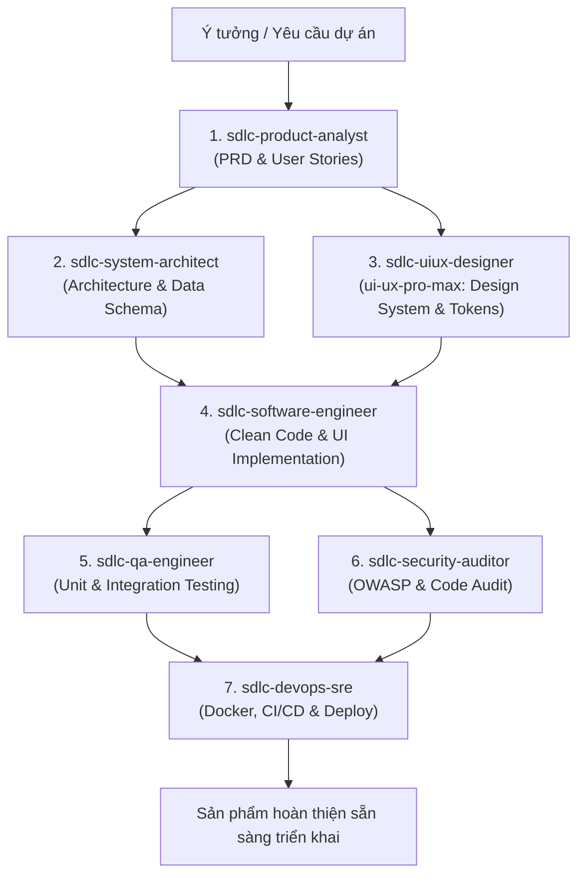

# SDLC Agent Team Framework (MySSH)

Bộ 7 AI Agents chuyên môn hóa cho toàn bộ vòng đời phát triển phần mềm (Software Development Life Cycle - SDLC), tích hợp bộ kỹ năng thiết kế chuyên sâu `ui-ux-pro-max`:

| Giai đoạn | Agent Name | Vai trò chuyên môn | Sức mạnh & Đầu ra chính (Deliverables) |
| :--- | :--- | :--- | :--- |
| **1. Requirements** | `sdlc-product-analyst` | Senior Product Manager & BA | PRD, User Stories, Gherkin Acceptance Criteria, Scope Matrix |
| **2. Architecture** | `sdlc-system-architect` | Principal System Architect & Tech Lead | Tech Spec, System/C4 Diagrams, ERD, API Contracts (OpenAPI) |
| **3. UI/UX Design** | `sdlc-uiux-designer` | Lead UI/UX Designer & Design System | Tích hợp **ui-ux-pro-max-skill**, Design Tokens, Palettes, Wireframes, UX Guidelines |
| **4. Implementation** | `sdlc-software-engineer` | Senior Core/Fullstack Engineer | Clean Code, Business Logic, Migrations, App Scaffolding, UI Components |
| **5. Testing & QA** | `sdlc-qa-engineer` | Lead QA & Test Automation Specialist | Test Strategy, Unit/Integration/E2E Tests, Edge Case Coverage |
| **6. Security Review** | `sdlc-security-auditor` | Staff Security Engineer & Code Reviewer | Security Audit Report (OWASP), Secret Checks, Perf Review |
| **7. DevOps & Release**| `sdlc-devops-sre` | Senior DevOps & SRE Engineer | Multi-stage Dockerfile, CI/CD Actions, Health Checks, SemVer |

---

## Quy trình luân chuyển dữ liệu (Lifecycle Workflow)



---

## Bộ công cụ hỗ trợ UI/UX (`ui-ux-pro-max-skill`)

Agent `sdlc-uiux-designer` sử dụng trực tiếp công cụ tìm kiếm tri thức thiết kế offline tại:
`.agents/skills/ui-ux-pro-max/scripts/search.py`

Các lệnh tra cứu nhanh:
- **Tạo Design System hoàn chỉnh**:
  ```bash
  python3 .agents/skills/ui-ux-pro-max/scripts/search.py "<loại_sản_phẩm> <từ_khóa>" --design-system -p "Tên_Dự_Án"
  ```
- **Tra cứu bảng màu / phong cách / typography**:
  ```bash
  python3 .agents/skills/ui-ux-pro-max/scripts/search.py "<query>" --domain style
  python3 .agents/skills/ui-ux-pro-max/scripts/search.py "<query>" --domain color
  python3 .agents/skills/ui-ux-pro-max/scripts/search.py "<query>" --domain typography
  python3 .agents/skills/ui-ux-pro-max/scripts/search.py "<query>" --domain ux
  python3 .agents/skills/ui-ux-pro-max/scripts/search.py "<query>" --stack <react|vue|flutter|tailwind>
  ```

---

## Hướng dẫn điều phối (Orchestration Commands)

1. **Phân tích nghiệp vụ**: *"Kích hoạt sdlc-product-analyst để phân tích tính năng X"*
2. **Thiết kế kiến trúc**: *"Kích hoạt sdlc-system-architect để lên kiến trúc và DB schema"*
3. **Thiết kế giao diện UI/UX**: *"Kích hoạt sdlc-uiux-designer để tạo design system và giao diện cho tính năng X"*
4. **Phát triển mã nguồn**: *"Kích hoạt sdlc-software-engineer để lập trình tính năng"*
5. **Kiểm thử**: *"Kích hoạt sdlc-qa-engineer để viết unit test và kiểm tra coverage"*
6. **Đánh giá bảo mật**: *"Kích hoạt sdlc-security-auditor để rà soát lỗ hổng và code smell"*
7. **Đóng gói triển khai**: *"Kích hoạt sdlc-devops-sre để tạo Dockerfile và CI/CD workflow"*
