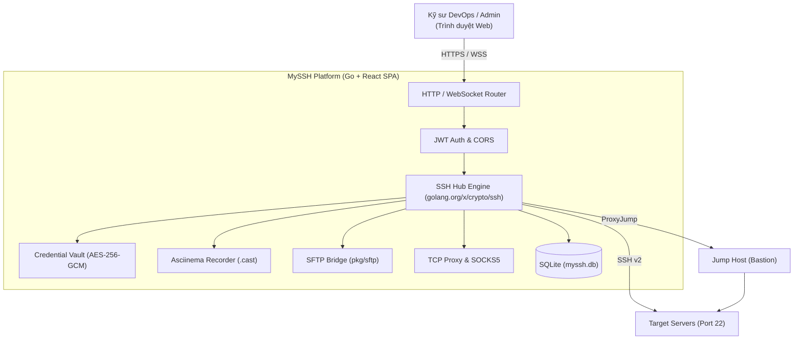

# MySSH - Web Bastion & Access Management Platform

[](https://golang.org)
[](https://react.dev)
[](https://xtermjs.org)
[](LICENSE)
[](#security--cryptography)

> Giải pháp Web-based SSH Jump Server & Bastion Host hiện đại, gọn nhẹ và bảo mật cao. Quản lý toàn bộ hạ tầng máy chủ và truy cập terminal an toàn trực tiếp trên trình duyệt web mà không cần cài đặt phần mềm client.

---

## 🚀 Tính năng nổi bật (Key Features)

- 💻 **Web Interactive Terminal:** Truy cập shell Linux/BSD mượt mà qua trình duyệt (`xterm.js` + WebSocket). Hỗ trợ đổi kích thước PTY linh hoạt, đa tab (Multi-tab) mở nhiều máy chủ đồng thời.
- 🔐 **Zero-Trust Credential Vault:** Bảo vệ SSH Private Keys (RSA, Ed25519) và mật khẩu bằng thuật toán mã hóa **AES-256-GCM** với khóa dẫn xuất **Argon2id**. Kỹ sư truy cập không bao giờ nhìn thấy Private Key thô.
- 🔑 **Ed25519 Key Generator:** Tự động sinh cặp khóa SSH Ed25519 một chạm trực tiếp trên giao diện và sao chép Public Key vào clipboard.
- 🎥 **Session Audit & Replay:** Ghi hình toàn bộ dữ liệu I/O của phiên làm việc theo chuẩn **Asciinema v2 (`.cast`)** và cung cấp Web Player xem lại phiên với tốc độ 1x, 2x, 4x phục vụ kiểm toán an toàn thông tin.
- 📁 **SFTP File Explorer:** Trình quản lý tệp tin đồ họa: duyệt thư mục từ xa, tải lên (upload), tải xuống (download), tạo thư mục và xóa tệp.
- 🔀 **SSH Port Forwarding & Tunnels:** Thiết lập và quản lý Local Port Forwarding và Dynamic SOCKS5 Proxy qua kết nối SSH.
- 🦘 **Jump Host Support:** Kết nối xuyên qua Bastion / Jump Server trung gian (ProxyJump) tới các máy chủ nằm sâu trong Private Subnet.
- 📦 **Single Binary Deployment:** Biên dịch 1 file nhị phân duy nhất nhúng sẵn toàn bộ Web UI, sử dụng SQLite Pure Go không cần cài đặt CGO/GCC.

---

## 🏛️ Sơ đồ kiến trúc (System Architecture)



---

## ⚡ Khởi chạy nhanh (Quick Start)

### 1. Sử dụng Docker Compose (Khuyến nghị)

```bash
# Clone dự án
git clone https://github.com/myssh/myssh.git
cd MySSH

# Khởi chạy dịch vụ
docker compose up -d
```
Truy cập giao diện tại: **`http://localhost:8080`**

### 2. Biên dịch và chạy từ mã nguồn (Native Binary)

**Yêu cầu:** Go 1.22+ và Node.js 20+

```bash
# 1. Cài đặt và build frontend
cd web && pnpm install && pnpm build && cd ..

# 2. Biên dịch Go binary
go build -ldflags="-s -w" -o bin/myssh ./cmd/server

# 3. Khởi chạy server
./bin/myssh
```

---

## 🔑 Tài khoản mặc định (Default Credentials)

Hệ thống tự động khởi tạo tài khoản quản trị viên trong lần khởi chạy đầu tiên:

- **Tên đăng nhập:** `admin`
- **Mật khẩu:** `admin123`

> ⚠️ **Lưu ý bảo mật:** Hãy đổi mật khẩu ngay sau khi đăng nhập vào hệ thống lần đầu!

---

## ⚙️ Biến môi trường cấu hình (Configuration)

| Tên biến | Giá trị mặc định | Mô tả |
| :--- | :--- | :--- |
| `PORT` | `8080` | Cổng HTTP / WebSocket lắng nghe |
| `DB_PATH` | `data/myssh.db` | Đường dẫn file cơ sở dữ liệu SQLite |
| `DATA_DIR` | `data` | Thư mục lưu trữ dữ liệu ứng dụng |
| `RECORDINGS_DIR`| `data/recordings` | Thư mục lưu file ghi hình phiên `.cast` |
| `MASTER_KEY` | *(Tự sinh hoặc đặt)* | Chuỗi khóa mã hóa chính cho Credential Vault (AES-256-GCM) |
| `JWT_SECRET` | *(Tự sinh hoặc đặt)* | Secret key ký và xác thực JWT token |

---

## 🧪 Kiểm thử (Testing)

Dự án có đầy đủ bộ Unit Tests cho các module cốt lõi (Crypto, Keygen, Recorder, JWT, Middleware):

```bash
# Chạy toàn bộ Unit Tests
go test -v ./...
```

---

## 👥 Đội ngũ SDLC Agents & Tài liệu thiết kế

Dự án này được thiết kế và triển khai hoàn thiện theo quy trình **SDLC Framework**:

1. **Requirements & Scope:** [`docs/PRD.md`](file:///Users/thangle/Desktop/Workspace/Coding/MySSH/docs/PRD.md) bởi `sdlc-product-analyst`
2. **Architecture & C4 Specs:** [`docs/ARCHITECTURE.md`](file:///Users/thangle/Desktop/Workspace/Coding/MySSH/docs/ARCHITECTURE.md) bởi `sdlc-system-architect`
3. **Core Implementation:** Mã nguồn Clean Go & React SPA bởi `sdlc-software-engineer`
4. **Test & QA Strategy:** Bộ Unit Tests `*_test.go` bởi `sdlc-qa-engineer`
5. **Security Review & OWASP Audit:** [`docs/SECURITY_AUDIT.md`](file:///Users/thangle/Desktop/Workspace/Coding/MySSH/docs/SECURITY_AUDIT.md) bởi `sdlc-security-auditor`
6. **DevOps & Packaging:** `Dockerfile`, `docker-compose.yml`, `Makefile`, `.github/workflows/ci.yml` bởi `sdlc-devops-sre`

---

## 📄 License

Phát hành dưới giấy phép mã nguồn mở **MIT License**.
