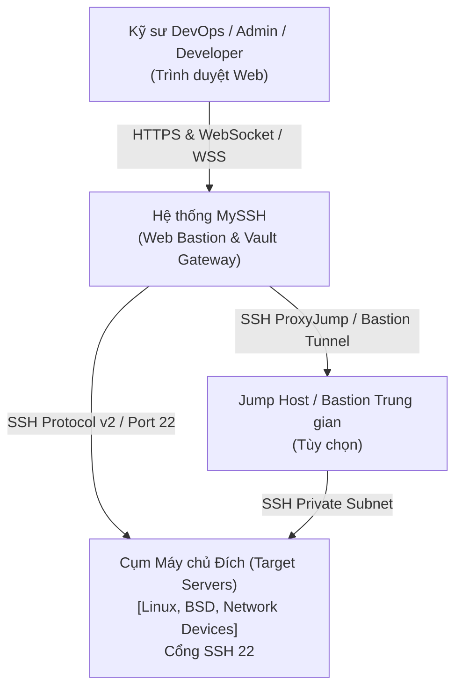
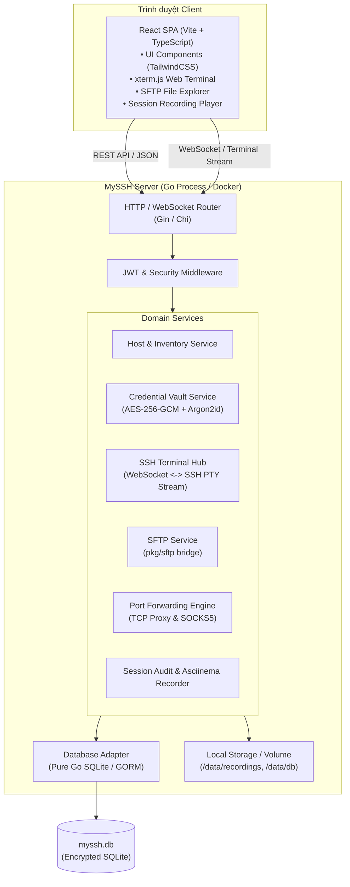
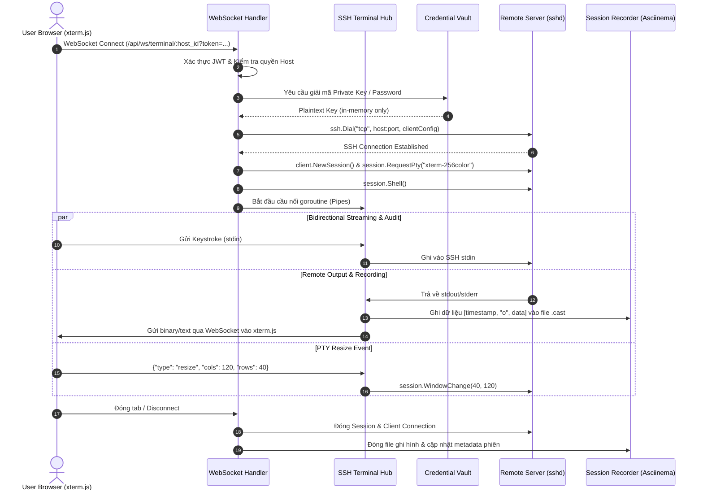
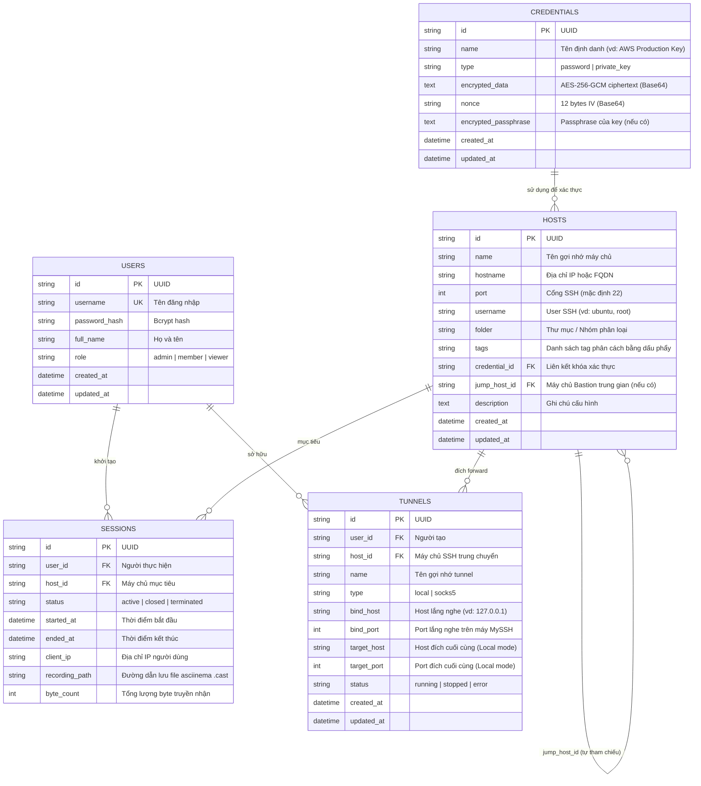

# System Architecture & Technical Specification - MySSH

**Dự án:** MySSH - Web-based SSH Bastion & Access Management Platform  
**Tác giả:** `sdlc-system-architect`  
**Phiên bản:** v1.0.0  
**Trạng thái:** Approved / Ready for Implementation  
**Ngày lập:** 04/11/2026  

---

## 1. Tổng quan kiến trúc hệ thống (System Architecture)

MySSH được xây dựng theo mô hình **Single-Binary Web Bastion** (Clean Architecture kết hợp Hexagonal Architecture), tối ưu hóa cho hiệu năng cao, tiêu tốn ít tài nguyên và dễ dàng triển khai:
- **Backend Core Engine:** Viết bằng **Go (Golang)** tận dụng tối đa goroutines, non-blocking I/O và thư viện SSH tiêu chuẩn công nghiệp `golang.org/x/crypto/ssh`.
- **Database:** **SQLite (Pure Go - `modernc.org/sqlite`)** cho phép biên dịch CGO-free, triển khai gọn nhẹ 1 file nhị phân duy nhất, đồng thời hỗ trợ chuyển đổi sang PostgreSQL khi mở rộng quy mô.
- **Frontend SPA:** **React (Vite + TypeScript + TailwindCSS)** tích hợp `xterm.js` cho Web Terminal siêu mượt mà.
- **Security Engine:** Module mã hóa **AES-256-GCM** kết hợp hàm tạo khóa dẫn xuất **Argon2id** để bảo vệ tuyệt đối Private Keys và Passwords.

---

## 2. Sơ đồ kiến trúc C4 (C4 Architectural Diagrams)

### C4 Level 1: System Context Diagram

### C4 Level 2: Container Diagram

### C4 Level 3: Terminal Stream Component Interaction (Sequence Diagram)

---

## 3. Thiết kế Cơ sở dữ liệu & ERD (Entity Relationship Diagram)

---

## 4. Kiến trúc bảo mật & Mã hóa (Security & Cryptographic Design)

### Cơ chế Master Key & Derivation
1. **Master Secret Key:** Cấu hình qua biến môi trường `MYSSH_MASTER_KEY` hoặc tự động sinh ngẫu nhiên 32-byte an toàn lưu trong tệp bảo mật `data/master.key` khi khởi động lần đầu.
2. **KDF (Key Derivation Function):** Sử dụng **Argon2id** (Memory: 64MB, Iterations: 3, Parallelism: 2) để dẫn xuất encryption key 256-bit.
3. **Mã hóa đối xứng:** **AES-256-GCM (Galois/Counter Mode)**:
   - Cung cấp tính bảo mật (Confidentiality) và tính toàn vẹn (Authenticated Encryption with Associated Data - AEAD).
   - Mỗi lần mã hóa tạo ra một `Nonce` ngẫu nhiên 12-byte duy nhất (Cryptographically Secure Pseudo-Random Number Generator - `crypto/rand`).
   - Plaintext private key chỉ tồn tại trong bộ nhớ RAM trong thời gian thiết lập phiên bắt tay SSH, sau đó được zero-out.

---

## 5. Đặc tả API Contract (RESTful & WebSocket Endpoints)

### A. Authentication & User API
- `POST /api/auth/login` - Đăng nhập tài khoản, trả về JWT Token & thông tin người dùng.
- `GET /api/auth/me` - Kiểm tra trạng thái đăng nhập hiện tại.
- `POST /api/auth/logout` - Đăng xuất và vô hiệu hóa phiên.

### B. Host & Credential API
- `GET /api/hosts` - Lấy danh sách máy chủ (hỗ trợ filter theo folder, search query).
- `POST /api/hosts` - Tạo mới thông tin máy chủ.
- `GET /api/hosts/:id` - Lấy chi tiết thông tin máy chủ.
- `PUT /api/hosts/:id` - Cập nhật thông tin máy chủ.
- `DELETE /api/hosts/:id` - Xóa máy chủ.
- `POST /api/hosts/:id/test` - Kiểm tra kết nối SSH tới máy chủ.
- `GET /api/credentials` - Lấy danh sách định danh (không bao gồm private key thô).
- `POST /api/credentials` - Lưu mới credential (mã hóa tự động).
- `DELETE /api/credentials/:id` - Xóa credential.
- `POST /api/credentials/generate-key` - Sinh ngẫu nhiên cặp khóa Ed25519 mới.

### C. Terminal & WebSocket Stream
- `WS /api/ws/terminal/:host_id`
  - Headers/Query: `?token=<jwt_token>&cols=120&rows=40`
  - Tin nhắn Client gửi:
    - Text/Binary: Dữ liệu nhập từ bàn phím.
    - JSON Control: `{"type": "resize", "cols": 120, "rows": 40}`
  - Tin nhắn Server gửi: Dữ liệu stream đầu ra từ SSH PTY.

### D. SFTP File Manager API
- `GET /api/sftp/:host_id/list?path=/root` - Lấy danh sách file và thư mục.
- `GET /api/sftp/:host_id/download?path=/root/app.log` - Tải file về máy.
- `POST /api/sftp/:host_id/upload?path=/root` - Tải file lên (Multipart form).
- `POST /api/sftp/:host_id/mkdir` - Tạo thư mục mới.
- `DELETE /api/sftp/:host_id/delete?path=...` - Xóa file hoặc thư mục.

### E. Session Audit API
- `GET /api/audit/sessions` - Lấy danh sách lịch sử phiên làm việc.
- `GET /api/audit/sessions/:id/recording` - Tải luồng file `.cast` để phát lại trên Web Player.

### F. Tunnel & Port Forwarding API
- `GET /api/tunnels` - Danh sách tunnel.
- `POST /api/tunnels` - Tạo mới tunnel.
- `POST /api/tunnels/:id/start` - Bật chạy tunnel.
- `POST /api/tunnels/:id/stop` - Dừng tunnel.
- `DELETE /api/tunnels/:id` - Xóa cấu hình tunnel.

---

## 6. Phê duyệt & Chuyển giao (Handoff)

Tài liệu Kiến trúc này được `sdlc-system-architect` phê duyệt và bàn giao cho **`sdlc-software-engineer`** để bắt đầu hiện thực hóa mã nguồn (Scaffolding, Backend Core, Web Frontend).
